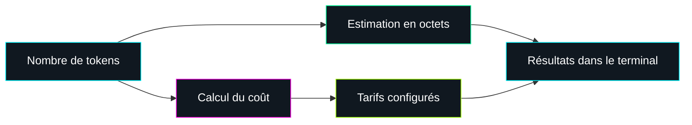

<div align="center">


<br>

**`UN OUTIL LOCAL. DES ESTIMATIONS. ZÉRO MAGIE.`**

*Explore les tokens. Estime les coûts. Garde le contrôle.*

<br>


</div>

---

## `> À PROPOS`

**Nexus Tokenizer** est un outil en Bash qui transforme un nombre de tokens en
estimations faciles à lire : taille approximative en octets et coût calculé à
partir des tarifs configurés dans le script.

```text
[ OK ]  Conversion tokens ↔ octets
[ OK ]  Estimation des coûts
[ OK ]  Comparaison indicative des tarifs de cache
[ OK ]  Mode interactif dans le terminal
```

> **Mode légal :** l’outil sert uniquement à effectuer des estimations. Il ne
> pirate rien, ne contourne aucune limite et ne contacte aucun modèle d’IA.

## `> DÉMARRAGE RAPIDE`

```bash
git clone <URL_DE_TON_DEPOT>
cd <NOM_DE_TON_DEPOT>

chmod +x nexus-token-converter.sh
./nexus-token-converter.sh
```

Prérequis : **Bash 4+** et **Python 3**.

<details>
<summary><code>[+] Lancer sans rendre le script exécutable</code></summary>

```bash
bash nexus-token-converter.sh
```

</details>

## `> TERMINAL`

Le script affiche ses conversions et estimations, puis propose un mode interactif :

```text
Entrez un nombre de tokens (ou Entrée pour quitter) : 100000

100000 tokens
Octets : 400000
Mo : 0.3815

Coût par modèle :
gemini-pro          input: ...
gemini-flash        input: ...
```

Saisis un nombre entier pour obtenir une estimation. Appuie sur **Entrée** sans
rien écrire ou tape `q` pour quitter.

## `> SCHÉMA DU SYSTÈME`



## `> PERSONNALISATION`

Les tarifs sont enregistrés dans le script. Modifie les valeurs correspondantes
pour effectuer tes propres estimations.

```text
coût estimé = (nombre de tokens / 1 000 000) × tarif par million
```

<details>
<summary><code>[+] Afficher les limites et les précautions</code></summary>

- « 1 token ≈ 4 octets » est une approximation : la taille varie selon le texte,
  la langue et le modèle.
- Les tarifs sont inscrits manuellement dans le script. Vérifie qu’ils sont
  adaptés au modèle et aux conditions de facturation que tu veux estimer.
- La valeur monétaire fixe attribuée à un token dans le script n’est pas une
  valeur universelle ni une mesure économique vérifiée.
- Les résultats sont indicatifs et ne sont pas des tarifs officiels.

</details>

## `> MODE D'EMPLOI`

1. Lance le script dans un terminal.
2. Saisis le nombre de tokens à estimer.
3. Lis les conversions et les coûts affichés.
4. Modifie les tarifs dans le script si nécessaire.

## `> PROJET`

```text
nexus-tokenizer/
├── nexus-token-converter.sh
├── README.md
└── .gitignore
```

<div align="center">

**`END OF TRANSMISSION`**

*Estime intelligemment. Vérifie les tarifs. Reste dans le légal.*

</div>
